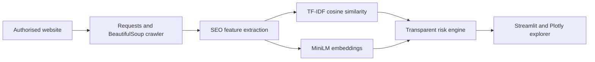

# SEONEX v0.1

**SEONEX — SEO Neural Explainability and Conflict Explorer** is an explainable prototype for identifying page pairs that may deserve a keyword-cannibalization review. It crawls an authorised website, extracts page content, calculates TF-IDF keyword similarity and Sentence Transformer semantic similarity, then displays the evidence in a Catppuccin-inspired Streamlit dashboard.

> A SEONEX score is a project-defined diagnostic signal. It is not Google's ranking algorithm, a probability of cannibalization, or a promise of ranking improvements.

## Features

- Original, responsive 10-page Brightside demonstration website
- Same-origin crawler with robots.txt checks, timeout, duplicate URL handling, rate limiting, and local-demo safety gate
- Real title, description, H1/H2, visible-text, word-count, canonical, and internal-link extraction
- TF-IDF cosine similarity with shared weighted terms
- `all-MiniLM-L6-v2` semantic similarity with in-memory embedding cache and clear failure reporting
- Transparent 50/50 keyword + semantic diagnostic score (keyword-only only when semantic analysis explicitly fails)
- Interactive overview scatter plot, page inventory, downloadable CSV, crawl errors, ranked pair explorer, and plain-English explanations

## Course project status

SEONEX and the assessed course website are separate components. The checked-in `website/` directory is a static local demonstration target for crawler testing; it is **not** WordPress and has not been deployed publicly. No VPS, domain, Cloudflare DNS, SSL, GA4, Search Console, backlink, or performance result is claimed.

Course evidence and current implementation status are tracked in [docs](docs/), including the proposed niche, deployment prerequisites, audit boundary, roadmap, testing record, and limitations. The proposed niche is community activities and event planning, pending your confirmation and real keyword/SERP research.

## Architecture



## Install (Windows PowerShell)

```powershell
cd "C:\Users\Major X\Documents\ASTRA 2"
py -m venv .venv
.\.venv\Scripts\Activate.ps1
pip install -r requirements.txt
```

The first semantic scan downloads the public `all-MiniLM-L6-v2` model. If unavailable (for example, offline), the UI clearly marks semantic similarity unavailable and never fabricates it.

## Run the bundled demo

Open two PowerShell terminals in the project folder with the virtual environment activated.

Terminal 1:

```powershell
py -m http.server 8000 --directory website
```

Terminal 2:

```powershell
streamlit run app.py
```

Open the dashboard URL, choose **Website Scanner**, leave **Use bundled local demo** enabled, confirm authorisation, and scan `http://localhost:8000`.

## Test

```powershell
pytest -q
```

For the same interpreter used by the virtual environment:

```powershell
.\.venv\Scripts\python.exe -m pytest -q
```

## Project layout

```text
app.py                 Streamlit product UI
seonex/                crawler, extraction, analysis, score, explanations
website/               original static demo site
tests/                 focused automated tests
data/crawls/           generated CSV snapshots (gitignored)
```

## Known limitations

- Semantic embeddings require a compatible Sentence Transformers installation and initial model download.
- The crawler is deliberately small and sequential; it suits authorised prototypes, not large-scale crawling.
- v0.1 does not classify search intent, make recommendations, edit websites, access Search Console, or produce evaluation metrics.

## Recommended v0.2

Add explainable search-intent classification, configurable multi-signal scoring, recommendation-review persistence, and before/after snapshot comparisons.
