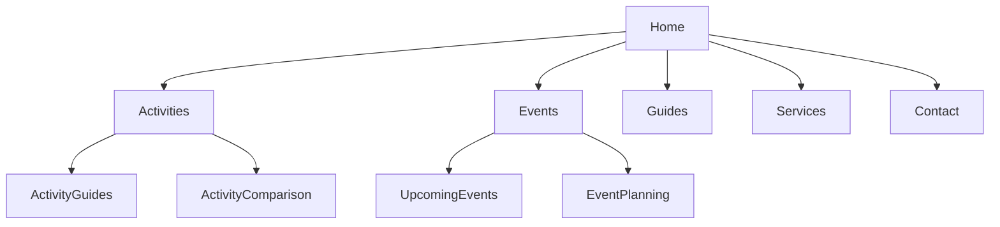

# Site architecture

## Current local demo

The local demo contains ten original content pages, navigation, canonical tags, a sitemap, and robots.txt. It is used to test SEONEX crawling only.

## Planned WordPress implementation

A WordPress site should use the same concise content architecture after a domain/VPS is available. WordPress will be a separate deployment target; the Streamlit scanner will analyse it only after its owner authorises a crawl.
